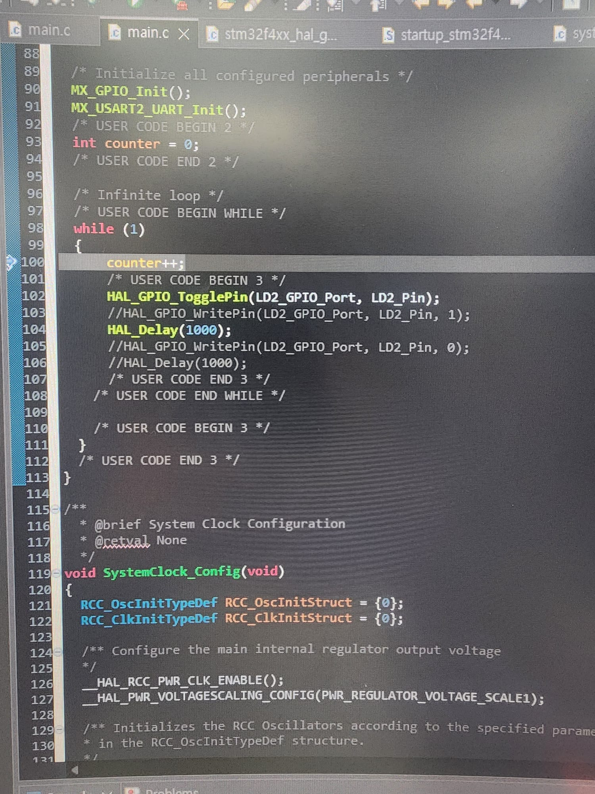
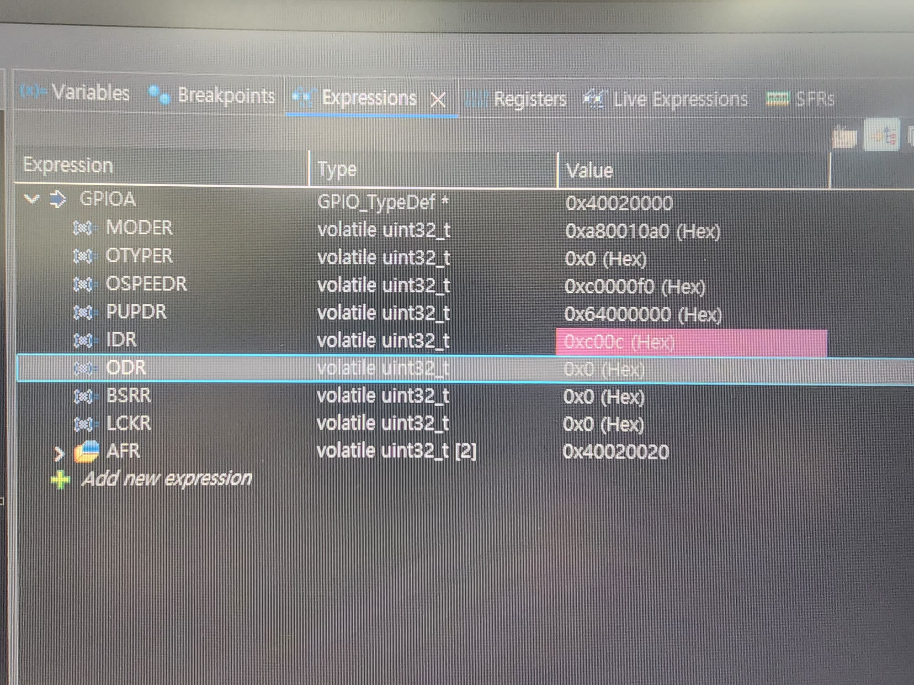
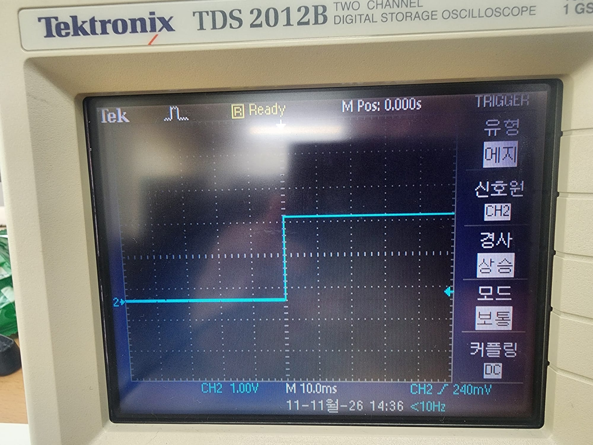
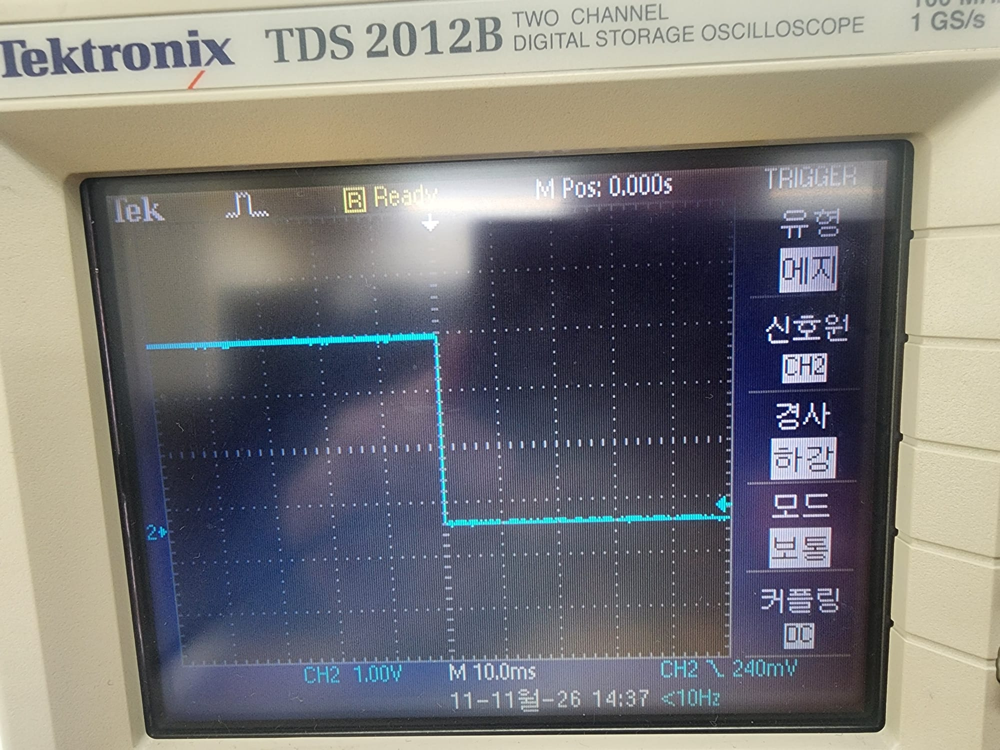

# GPIO — STM32F411 실습 기록

**실습일:** 2026년 11월 11일  
**실습 환경:** STM32CubeIDE · STM32F411 계열 보드 · Tektronix TDS 2012B

이번에는 **PA5에 연결된 LD2 LED 토글**과 **PA6 GPIO 핀의 출력 설정 확인**을 구분해 정리했다. STM32CubeIDE에서 작성한 코드, 직접 촬영한 레지스터 화면, 오실로스코프 파형을 기록했다.

- [STM32F411xC/E 데이터시트](https://www.st.com/resource/en/datasheet/stm32f411ce.pdf)
- [RM0383 레퍼런스 매뉴얼](https://www.st.com/resource/en/reference_manual/rm0383-stm32f411xce-advanced-armbased-32bit-mcus-stmicroelectronics.pdf)
- [교수님 원본 GPIO_DOC](https://github.com/gotree94/STM32/tree/main/NUCLEO_F411RE/GPIO_DOC)

## 목차

**직접 진행한 실습**

- [1. LED 토글 코드](#1-led-토글-코드)
- [2. GPIOA 레지스터 확인](#2-gpioa-레지스터-확인)
- [3. 오실로스코프 측정](#3-오실로스코프-측정)
- [4. 실습 결과 및 배운 점](#4-실습-결과-및-배운-점)

**교수님 자료에서 F411만 복습한 부분**

- [5.1 Architecture](#51-architecture)
- [5.2 CLOCK](#52-clock)
- [5.3 Memory Map](#53-memory-map)
- [5.4 GPIO Register](#54-gpio-register)
- [5.5 Test](#55-test)


## 1. LED 토글 코드

STM32CubeIDE의 `main.c`에서 `MX_GPIO_Init()` 호출 이후, 다음 반복문을 작성했다. `counter` 변수는 반복 횟수를 세기 위해 넣었다.

```c
int counter = 0;

while (1)
{
    counter++;
    HAL_GPIO_TogglePin(LD2_GPIO_Port, LD2_Pin);
    HAL_Delay(1000);
}
```



- `HAL_GPIO_TogglePin()`은 지정한 GPIO 출력 상태를 반전한다.
- `HAL_Delay(1000)`은 약 1초 동안 대기한다.
- 코드를 기준으로 출력이 약 1초마다 바뀌며, High와 Low가 한 번씩 반복되는 **한 주기는 약 2초**로 예상된다.

화면에서 주석 처리된 `HAL_GPIO_WritePin()`은 실행 중인 코드가 아니다. 이번 실습에 사용한 함수는 `HAL_GPIO_TogglePin()`이다.

## 2. GPIOA 레지스터 확인

STM32CubeIDE의 **Expressions** 창에서 `GPIOA`를 펼쳐 레지스터 값을 확인했다.



| 화면에서 확인한 항목 | 값 또는 의미 |
|---|---|
| GPIOA 시작 주소 | `0x40020000` |
| `MODER` | `0xA80010A0` — 핀 모드 설정 |
| `OTYPER` | `0x00000000` — 출력 방식 설정 |
| `ODR` | `0x00000000` — 촬영 시점의 출력 데이터 |
| `IDR` | `0x0000C00C` — 촬영 시점의 입력 상태 |

`MODER`는 각 핀당 2비트를 사용한다. 화면의 `0xA80010A0`을 해석하면 이 시점에서 **PA5는 입력(`00`), PA6은 출력(`01`)**으로 읽힌다.

코드에는 `LD2_Pin`이라는 이름이 사용되지만, 사진에는 해당 매크로가 실제로 어느 핀을 가리키는지 나와 있지 않다. 따라서 이 레지스터 캡처와 LED가 동작한 시점이 일치하는지는 추가로 확인해야 한다.

### 실습 구분: PA5는 LED, PA6은 외부 GPIO 핀

- **PA5 — LD2 LED:** NUCLEO-F411RE에서는 PA5가 보드 내장 LED(LD2)에 연결된다. 위 `HAL_GPIO_TogglePin(LD2_GPIO_Port, LD2_Pin)` 코드는 LED를 토글하기 위해 작성한 코드다.
- **PA6 — 외부 핀:** PA6은 별도의 GPIO 핀(Arduino D12)이다. 위 디버거 사진은 `MODER = 0xA80010A0`으로, **PA6이 출력 모드(`01`)**로 설정된 상태를 보여 준다. PA6을 내장 LED라고 설명하면 안 된다.

즉, **PA5 LED 토글**과 **PA6 핀 레지스터 확인**은 서로 구분해 기록한다. 디버거 화면에서는 PA5가 입력 모드로 읽히므로, 그 화면을 PA5 LED 토글의 레지스터 검증 사진으로 사용하지 않는다.

| 핀 | 출력 모드 설정에 쓰는 MODER 비트 | ODR 출력 High 비트 |
|---|---|---|
| PA5 | `MODER[11:10] = 01` → `0x00000400` | `0x20` |
| PA6 | `MODER[13:12] = 01` → `0x00001000` | `0x40` |

위 표의 비트값은 레지스터 비트 위치를 이해하기 위한 계산이다. PA6 출력 모드는 위 디버거 캡처에서 확인되지만, **PA6 핀의 전압을 몇 V로 측정했는지**는 이 사진으로 확정할 수 없다. `LD2_Pin`과 `MX_GPIO_Init()` 원본을 확인하면 PA5 LED 초기화 설정도 정확히 기록할 수 있다.

## 3. 오실로스코프 측정

Tektronix TDS 2012B의 CH2를 이용해 신호가 바뀌는 두 순간을 촬영했다.

**상승 에지 — Low에서 High로 변경**



**하강 에지 — High에서 Low로 변경**



사진에는 수직 눈금 **1.00 V/div**, 시간 눈금 **10.0 ms/div**가 표시되어 있다. 각각의 사진에서 상승·하강 에지를 확인할 수 있었다.

다만 사진에는 한 번의 에지만 나타나므로 **1초 간격과 전체 2초 주기를 직접 측정한 결과는 아니다.** 주기를 정확히 측정하려면 시간축을 길게 설정해 연속된 에지를 한 화면에 표시해야 한다.

## 4. 실습 결과 및 배운 점

GPIO 제어 코드를 실행하면 마이크로컨트롤러의 출력 핀 상태가 바뀌고, 오실로스코프로 전압 변화를 관찰할 수 있다는 것을 배웠다. 디버거에서는 GPIOA의 시작 주소와 레지스터 값을 확인했다.

또한 LED 토글 코드를 작성하는 것과 레지스터 값으로 동작을 검증하는 것은 별개라는 점을 알게 됐다. 다음에는 `main.h`의 `LD2_Pin` 정의와 `MX_GPIO_Init()`의 핀 설정을 비교하고, 실제 출력 주기를 측정해 보고 싶다.

**다음 확인 항목**

- [ ] `LD2_Pin`의 실제 포트·핀 번호 확인
- [ ] GPIO 초기화 이후 `MODER` 값 확인
- [ ] 연속 파형으로 출력 주기·주파수 직접 측정

---

## 5. 교수님 GPIO_DOC 복습 — STM32F411만

아래 5개 접기식 항목은 교수님이 공개한 [GPIO_DOC](https://github.com/gotree94/STM32/tree/main/NUCLEO_F411RE/GPIO_DOC)에서 **F411에 해당하는 설명과 그림**을 바탕으로 정리했다. 그림은 교수님 원본 저장소의 이미지를 링크했다. **이 그림들은 직접 촬영한 실습 결과가 아니라 참고자료**다. 직접 진행한 실습은 위 1~4절에 따로 기록했다.


아래는 [교수님 GPIO_DOC](https://github.com/gotree94/STM32/tree/main/NUCLEO_F411RE/GPIO_DOC)에서 **F411에 해당하는 설명과 그림**을 항목별로 다시 정리한 것이다. 그림은 수업 자료의 원본 링크로 표시하고, 위 1~5절의 실습 사진과 구분했다. 제목을 눌러 펼칠 수 있다.

### 5.1 Architecture

<details>
<summary><strong>Architecture — STM32F411 (그림 2장)</strong></summary>

Cortex-M4는 코드를 실행하고, AHB 버스를 통해 GPIO와 같은 주변장치 레지스터에 접근한다. STM32F411에서 GPIO는 AHB1 쪽에 연결된다.

**시스템 버스 구조**


**Cortex-M4와 버스 연결**


</details>

### 5.2 CLOCK

<details>
<summary><strong>CLOCK — STM32F411 (그림 2장)</strong></summary>

GPIO를 사용하려면 먼저 RCC에서 해당 포트의 클록을 켜야 한다. `MX_GPIO_Init()` 코드에서 GPIOA 클록 활성화 부분을 확인할 수 있다.

**STM32F411 클록 구조 (1)**


**STM32F411 클록 구조 (2)**


</details>

### 5.3 Memory Map

<details>
<summary><strong>Memory Map — STM32F411 (그림 4장)</strong></summary>

GPIOA 레지스터는 `0x40020000`부터 시작한다. 예를 들어 `MODER`는 `+0x00`, `ODR`은 `+0x14`, `BSRR`은 `+0x18`에 있다.

**메모리 구조**


**주변장치 주소**


**AHB 주소 영역**


**GPIO 주소 확인**


</details>

### 5.4 GPIO Register

<details>
<summary><strong>GPIO — STM32F411 (그림 15장)</strong></summary>

GPIO 핀은 입력, 출력, 대체 기능, 아날로그 모드 중 하나로 설정한다. LED를 제어할 때는 출력 모드와 ODR·BSRR의 역할이 중요하다.

**GPIO 기본 구성**


**입력 모드**


**출력 모드**


**대체 기능**


**아날로그 모드**


**MODER 비트**


**레지스터 842**


**레지스터 843**


**레지스터 844**


**레지스터 845**


**레지스터 846**


**레지스터 847**


**레지스터 848**


**레지스터 849**


**AFR 비트**


</details>

### 5.5 Test

<details>
<summary><strong>Test — STM32F411 (그림 15장)</strong></summary>

교수님 예제는 `WritePin()`을 사용하는 디버깅 순서이다. 직접 기록한 실습 코드는 `TogglePin()`을 사용했으므로 두 코드를 동일하게 취급하지 않는다.

**Expressions에서 포트 확인**


**SFR 창**


**CPU 코어 레지스터**


**Disassembly 메뉴**


**Disassembly 화면**


**코어 구성**


**Memory 창**


**HAL_Init**


**SystemClock_Config**


**MX_GPIO_Init**


**USART2 초기화 예시**


**WritePin High**


**HAL_Delay**


**WritePin Low**


**다음 HAL_Delay**


**내 실습과의 차이:** 수업 자료는 `HAL_GPIO_WritePin()`으로 High/Low를 지정해서 확인하고, 내 코드에서는 `HAL_GPIO_TogglePin()`을 사용해 현재 상태를 반전했다.

</details>


## 참고자료 및 확인할 점

- [ST STM32F411xC/E 데이터시트](https://www.st.com/resource/en/datasheet/stm32f411ce.pdf)
- [ST RM0383 레퍼런스 매뉴얼](https://www.st.com/resource/en/reference_manual/rm0383-stm32f411xce-advanced-armbased-32bit-mcus-stmicroelectronics.pdf)
- [교수님 STM32F411 GPIO_DOC 원문](https://github.com/gotree94/STM32/tree/main/NUCLEO_F411RE/GPIO_DOC)
- [STM32F411 GPIO 정리 사례](https://github.com/yeooooly/STM32F411_Project/tree/main/01_GPIO_DOC) — PA5 토글 실습과 PA6 레지스터 실습을 나누어 정리하는 방식만 참고. 해당 저장소의 사진과 측정값을 본인 실습 결과로 사용하지 않음.

PA5는 LD2 LED 제어 핀이고 PA6은 별도로 확인한 GPIO 출력 핀이다. `MODER = 0xA80010A0`은 **PA6 출력 모드**를 보여 주는 화면이지 PA5 LED 출력 모드의 증거가 아니다. PA5에 사용된 `LD2_Pin` 매크로와 초기화 설정 원본은 추가 확인이 필요하다. 또한 오실로스코프 사진은 상승·하강 에지를 보여주지만 2초 주기 자체를 계측한 증거는 아니다.
