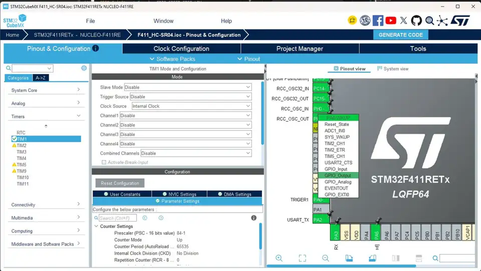
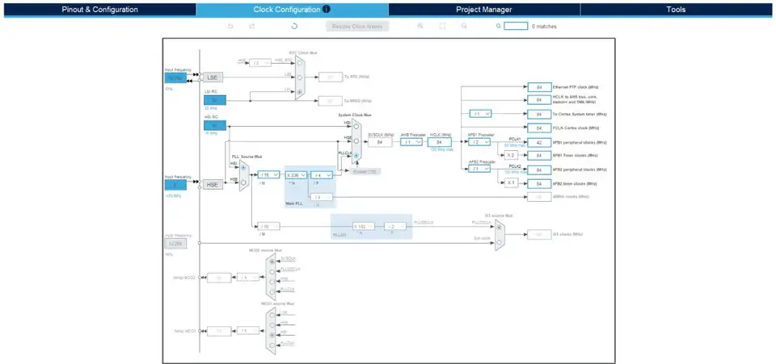
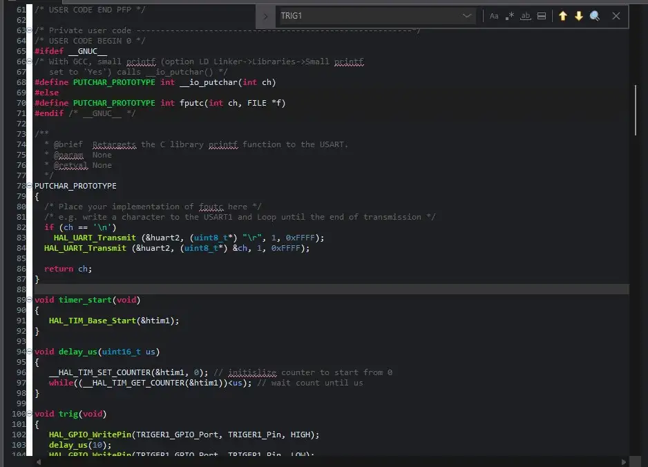
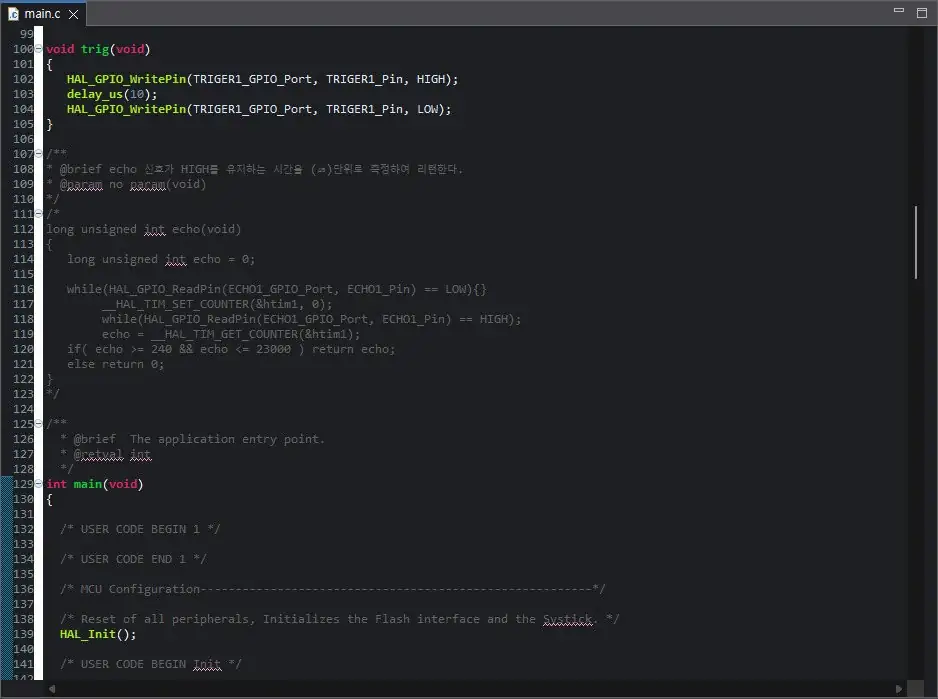
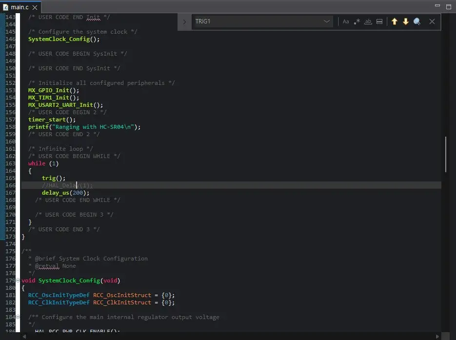
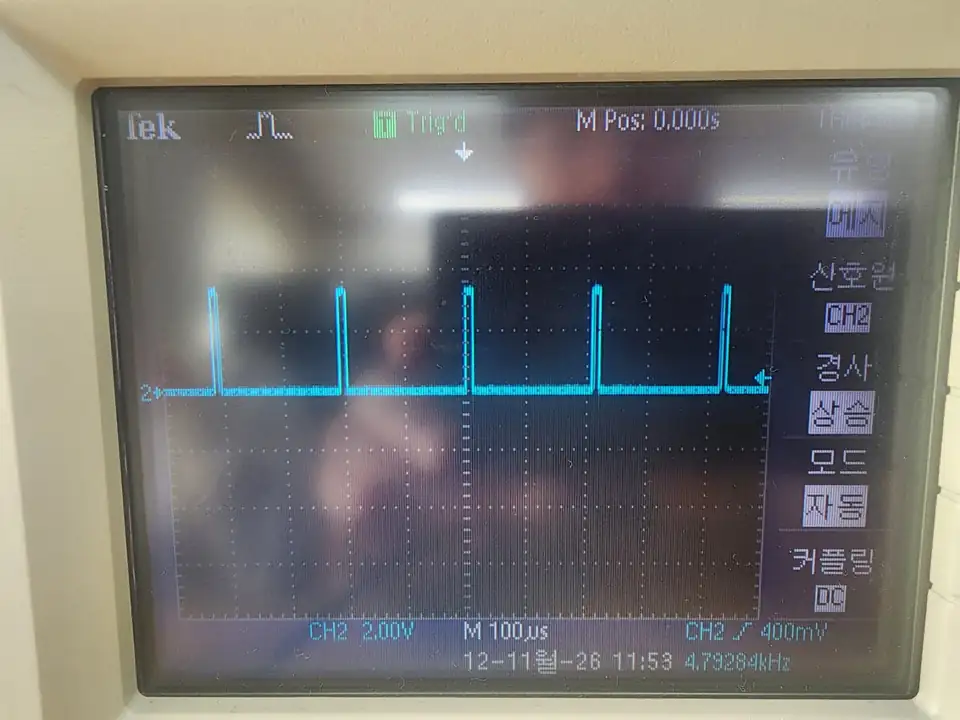
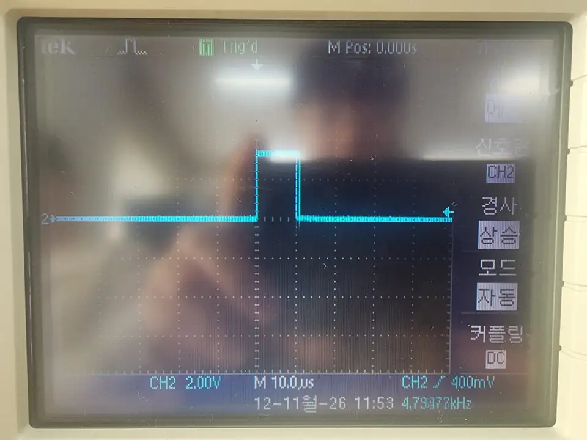
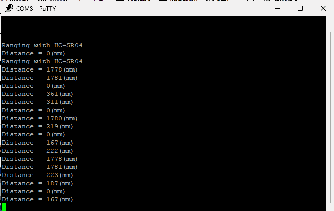

# HC-SR04 — TRIG 펄스 실습 (STM32F411RE)

**실습일:** 2026-11-12  
**보드:** NUCLEO-F411RE (STM32F411RETx)  
**개발 환경:** STM32CubeMX · STM32CubeIDE · Tektronix 오실로스코프

교수님 [F103RB HC-SR04 실습](https://github.com/gotree94/STM32/tree/main/NUCLEO_F103RB/06.HC-SR04)을 참고하되, **내가 실제 사용한 보드는 STM32F411RE**다. **오전에는 TRIG 펄스 생성과 오실로스코프 관찰**, **오후에는 ECHO를 이용한 거리값 출력**을 진행했다. 오전 코드·파형 사진 7장과 오후 PuTTY 출력 화면 1장을 기록했다. 거리가 정확한지는 별도 검증이 필요하다.

## 1. STM32CubeMX 설정



- **PA0 (Arduino A0):** `TRIGER1`이라는 GPIO Output으로 설정해 **TRIG 신호를 출력**했다.
- **PA1 (Arduino A1):** 오후 실습에서 **ECHO 신호를 받는 입력 핀**으로 사용했다(사용자가 확인한 연결). 오후 코드의 GPIO 초기화 설정은 별도 사진으로 확인하지 못했다.
- **TIM1:** Internal Clock, Prescaler `84-1`, Auto Reload `65535`



- **SYSCLK / HCLK:** 84 MHz
- **APB1 PCLK1:** 42 MHz
- **APB2 PCLK2 / Timer Clock:** 84 MHz

TIM1 카운터는 **84 MHz ÷ 84 = 1 MHz**로 동작하도록 설정했으므로, 카운터 1이 증가하는 시간은 약 **1 µs**다.

## 2. 작성한 코드

### 타이머 시작과 마이크로초 단위 지연



```c
void timer_start(void)
{
    HAL_TIM_Base_Start(&htim1);
}

void delay_us(uint16_t us)
{
    __HAL_TIM_SET_COUNTER(&htim1, 0);
    while (__HAL_TIM_GET_COUNTER(&htim1) < us);
}
```

### TRIG 펄스 출력



```c
void trig(void)
{
    HAL_GPIO_WritePin(TRIGER1_GPIO_Port, TRIGER1_Pin, HIGH);
    delay_us(10);
    HAL_GPIO_WritePin(TRIGER1_GPIO_Port, TRIGER1_Pin, LOW);
}
```

TRIG를 High로 만든 다음 `delay_us(10)`을 실행하고 Low로 복귀시킨다. 함수 실행 오버헤드가 있으므로 정확한 펄스 폭은 계측값으로 확인해야 한다.

### 메인 반복문



```c
MX_GPIO_Init();
MX_TIM1_Init();
MX_USART2_UART_Init();
timer_start();
printf("Ranging with HC-SR04\n");

while (1)
{
    trig();
    // HAL_Delay(1);
    delay_us(200);
}
```

`delay_us(200)`은 **TRIG 펄스를 낸 뒤** 실행되는 코드상의 지연이다. 펄스 폭 10 µs와 지연 200 µs를 합하면 반복 주기는 약 210 µs 이상이 된다. 실제 주기는 함수 실행시간 등으로 달라질 수 있다.

## 3. HAL 함수 사용 및 확인

**HAL(Hardware Abstraction Layer)**은 STM32의 GPIO, 타이머, UART 같은 하드웨어를 C 함수로 제어할 수 있게 해주는 라이브러리다. 이번에 촬영한 `main.c`에는 HAL 함수를 사용한 코드가 확인된다.

| 사진에서 확인한 함수 | 이번 코드에서 한 역할 |
|---|---|
| `HAL_Init()` | 프로그램 시작 시 HAL 초기화 |
| `HAL_TIM_Base_Start(&htim1)` | TIM1 카운터 동작 시작 |
| `HAL_GPIO_WritePin(..., HIGH)` | TRIG 핀을 High로 설정 |
| `HAL_GPIO_WritePin(..., LOW)` | TRIG 핀을 Low로 설정 |
| `HAL_UART_Transmit(&huart2, ...)` | `printf` 문자 출력을 USART2로 보내도록 연결한 코드 |

특히 **`delay_us()`는 HAL에서 제공하는 `HAL_Delay()`와 다른, TIM1 카운터를 이용해 작성한 사용자 함수**다. 이 함수 내부에서는 `__HAL_TIM_SET_COUNTER()`와 `__HAL_TIM_GET_COUNTER()` 매크로를 사용한다.

```c
// main.c에서 촬영된 코드
trig();
// HAL_Delay(1);  // 주석 처리됨: 실행하지 않음
delay_us(200);    // 실제 호출한 사용자 지연 함수
```

따라서 이번 실습에서 `HAL_Delay(1)`을 실행했다고 쓰면 안 된다. **HAL로 GPIO와 TIM1을 제어하면서, 타이머 카운터를 이용한 마이크로초 지연 함수를 함께 사용했다.** USART2 전송 코드는 보이지만 시리얼 터미널에서 실제 문자가 수신된 결과까지 확인한 것은 아니다.

## 4. 오실로스코프 사진

### 약 4.8 kHz의 반복 펄스



화면에는 CH2의 **100 µs/div** 시간축과 반복되는 좁은 펄스가 보인다. 우측 아래의 표시 주파수는 약 **4.8 kHz**다. 이는 약 200 µs 지연을 반복하는 코드와 규모가 비슷하다. 프로브가 연결된 핀은 사진으로만 식별되지 않아 **TRIG 핀을 측정했다는 것은 별도로 확인이 필요**하다.

### 펄스 한 개 확대



CH2 **10.0 µs/div** 화면에서 짧은 High 펄스가 관찰된다. 10 µs 수준의 펄스로 보이지만 사진에 표시된 정확한 펄스 폭 측정값은 없으므로 확정 숫자로 기록하지 않는다.

## 5. 오후 ECHO 거리 측정 결과

**연결:** PA0(A0) = **TRIG 출력**, PA1(A1) = **ECHO 입력**. 오전에는 TRIG 펄스만 확인했고, 오후에는 ECHO 신호를 이용한 거리 결과가 **PuTTY(COM8)** 창에 출력되는 것을 확인했다.



### PuTTY 출력에서 확인한 값

```text
Ranging with HC-SR04
Distance = 0(mm)
Ranging with HC-SR04
Distance = 1778(mm)
Distance = 1781(mm)
Distance = 0(mm)
Distance = 361(mm)
Distance = 311(mm)
Distance = 0(mm)
Distance = 1780(mm)
Distance = 219(mm)
...
Distance = 167(mm)
Distance = 222(mm)
Distance = 1778(mm)
Distance = 1781(mm)
Distance = 223(mm)
Distance = 187(mm)
Distance = 0(mm)
Distance = 167(mm)
```

코드에서 계산한 결과가 `Distance = ... (mm)` 형식으로 직렬 터미널에 표시됐다. **0mm가 반복되는 이유**, **약 167~361mm와 1,778~1,781mm 값이 교차하는 이유**는 현재 화면만으로 확정할 수 없다. 물체의 실제 거리·반사 조건·최종 코드가 제공되지 않았으므로 정확도 검증까지 완료한 것으로 쓰지 않는다.

### 오전과 오후의 진행 범위

| 시간 | 확인된 실습 |
|---|---|
| 오전 | TIM1 마이크로초 지연, `trig()` 작성, TRIG 펄스의 오실로스코프 관찰 |
| 오후 | **A0(PA0) TRIG / A1(PA1) ECHO** 연결, PuTTY COM8로 거리값 출력 확인 |

**주의:** 오전 사진에서는 `echo()` 함수가 주석 처리돼 있었다. 오후에는 실제 거리값이 출력됐으나 **오후 최종 `echo()` 함수의 소스코드와 오실로스코프 연결 상태**는 아직 확인하지 않았다. 따라서 오전 사진의 코드를 오후 최종 코드라고 설명하지 않는다.

또한 오전의 `delay_us(200)` 반복은 TRIG 펄스 관찰용 코드다. 이 값이 오후 거리 측정 코드에서도 그대로 쓰였다고 단정하지 않는다. ECHO 왕복 시간을 받기 전에 새로운 TRIG를 지나치게 빨리 보내면 측정값이 불안정할 수 있으므로 최종 반복 간격을 확인할 필요가 있다.

**참고:** 교수님 [HC-SR04 F103RB 예제](https://github.com/gotree94/STM32/tree/main/NUCLEO_F103RB/06.HC-SR04)는 학습 자료이고, 실제 사용한 MCU는 **STM32F411RE**다.

*사진 출처: 본인이 촬영해 제공한 화면 8장. 오전 사진 7장은 WebP, 오후 PuTTY 캡처 1장은 PNG 파일로 정리했다. 측정값이나 코드 내용을 임의로 바꾸지 않았다.*
